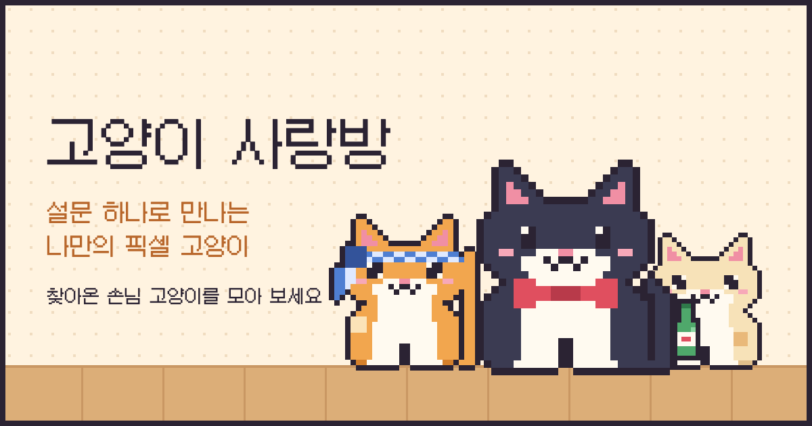
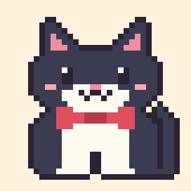
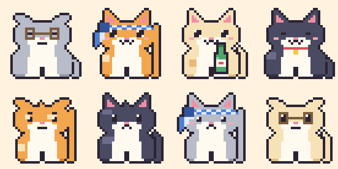
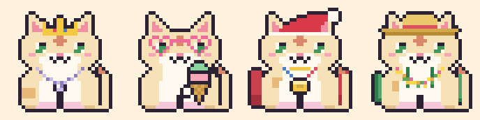
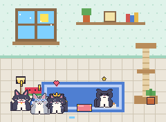

# 🐾 고양이 사랑방

> 귀엽지만 쓸 데 없고, 내가 즐거운 것을 만들자.
> 마치 귀여운 똥을 싸는 고양이처럼.  — *project cat-ddong*

설문에 답하면 **고양이가 된 나**, 즉 내 행동 패턴을 닮은 픽셀 고양이가 만들어지는 브라우저 서비스예요.
내 고양이는 고양이들이 모이는 **사랑방**의 호스트가 되어 손님 고양이들을 맞이하고, 만난 고양이는 **도감**에 모여요.
손님이 주는 **선물**로 꾸미고, 방을 **인테리어**하고, 도감 고양이들이 인사하는 **영상**으로 자랑할 수 있어요.

<p align="center">
  <a href="https://elain2.github.io/cat-ddong/"></a>
</p>

**▶ 바로 해보기: https://elain2.github.io/cat-ddong/**

<p align="center">
  <br>
  <sub>안내는 집사 고양이가 맡아요. 턱시도에 나비넥타이를 맨 뚱냥이예요.</sub>
</p>

## 어떻게 즐기나요

1. **입장**: 집사 고양이가 인사하며 설문을 시작해요.
2. **설문 13문항**: "쉬는 날 아침 눈을 떴다. 지금 기분은?" 같은 가벼운 객관식이에요. (질문마다 선택지는 2~4개)
   귀찮다면 **"설문 건너뛰고 바로 만들기"** 로 랜덤 고양이를 만들 수 있어요. 설문 도중에 **"건너뛰기"** 를 누르면 남은 문항만 랜덤이에요.
3. **이름**: 고양이가 된 나를 뭐라고 부를지 정해요. 입력한 이름이 곧 고양이 이름이에요. (비우면 지어 줘요)
4. **고양이 등장**: 답변이 성격과 외형이 되어 3프레임 애니메이션으로 나타나요. 처음엔 **맨몸**이에요.
5. **이유 풀이**: "귀가 커다래요 → 리액션이 아주 커요."처럼 왜 이렇게 생겼는지 알려줘요.
6. **사랑방 입장**: 방 안을 오가는 손님 고양이를 눌러 만나고, 선물을 받고, 도감을 채워요.

## 이런 고양이들이 나와요

<p align="center">
  <br>
  <sub>털색, 무늬, 귀, 꼬리, 체형, 털 결이 모두 답변에서 나와요. 악세사리는 없어요.</sub>
</p>

### 내 답변이 곧 외형이에요

설문은 행동 패턴으로 **성격 4축**을 재고, 외형은 각 답이 직관적으로 드러나는 곳에 은유로 나타나요.

| 질문이 묻는 것 | 외형에 나타나는 곳 | 은유 |
|---|---|---|
| 에너지 (느긋 / 보통 / 활발) | 체형, 꼬리, 눈 | 느긋: 통통하고 꼬리가 짧고 눈을 감고 있어요. 활발: 날씬하고 꼬리가 꼿꼿해요. |
| 사교성 (독립 / 보통 / 친화) | 귀, 입, 볼 | 독립: 귀가 눕고 입이 일자예요. 친화: 귀가 쫑긋하고 W 입에 볼이 발그레해요. |
| 섬세함 (털털 / 보통 / 예민) | 털 무늬 | 털털: 얼룩과 삐죽 털이 있어요. 예민: 깔끔한 단색이에요. |
| 대담함 (신중 / 보통 / 대범) | 눈 크기 | 신중: 작은 눈. 대범: 크고 반짝이는 눈. |
| 다른 사람 이야기를 들을 때 | 귀 모양 | 집중=쫑긋, 맞장구=동글, 흘려듣기=접힘, 큰 리액션=큰 귀 |
| 기분이 좋을 때 티 나는 정도 | 꼬리 | 속으로만=몽땅, 평소처럼=기본, 다 드러남=길게, 부풀어 오름=풍성 |
| 먹는 걸 좋아하는 정도 | 체형 | 소식=날씬, 적당히=기본, 먹보=통통 |
| 아침 머리 상태 | 털 결 | 깔끔=매끈, 살짝 뻗침=볼털, 폭탄=온몸 폭신 |
| 옷장 속 내 옷 | 무늬 | 무지=무늬 없음, 스트라이프=줄무늬, 도트=점박이, 포인트=귀·꼬리 끝이 진함 |
| 좋아하는 시간 + 쉬는 날 분위기 | 털색 (8가지) | 시간(아침/한낮/해질녘/밤) × 분위기(따뜻/시원). 따뜻: 크림·꿀색·오렌지·초콜릿, 시원: 화이트·블루·은회색·검정 |

선택지를 늘리지 않고 **질문을 나눠서** 조합을 키웠어요. 설문만으로 약 37만 가지가 나오고, 호스트 표식까지 곱하면 2,400만 가지 가까이 돼요.

### 악세사리는 선물로만 얻어요

설문은 악세사리를 정하지 않아요. 고양이는 맨몸으로 태어나고, 사랑방에서 **손님이 주는 선물**로만 꾸밀 수 있어요.

<p align="center">
  <br>
  <sub>왕관 + 진주 목걸이 · 하트 안경 + 아이스크림 · 산타모자 + 망토 + 메달 · 밀짚모자 + 배낭 + 꽃목걸이</sub>
</p>

### 시즌 한정 손님

| 계절 | 소품 | 손님 |
|---|---|---|
| 봄 | 벚꽃 머리핀 | 벚꽃이, 꽃비, 아지랑이 |
| 여름 | 선글라스 | 소다, 빙수, 파도 |
| 가을 | 단풍잎 | 도토리, 단풍이, 밤송이 |
| 겨울 | 목도리 | 눈꽃, 군고구마, 성에 |

방 배경이 그 계절일 때, 손님이 바뀔 때(30분마다)마다 한정 손님이 한 자리를 차지할 확률은 50%예요.
계절 버튼으로 배경을 바꾸면 그 계절 손님이 올지 다시 정해져요.

## 결과 해석하는 법

결과 카드는 위에서부터 **타이틀 → 이름 → 이유 풀이** 순서로 읽어요.

- **타이틀**은 에너지와 사교성을 조합한 9가지 중 하나예요. 무늬가 있으면 앞에 무늬 이름이 붙어요. (예: 줄무늬 동네 인싸 냥)
- **이름**은 내가 입력한 이름이에요. 비워 두면 시드로 지어 줘요. 집사의 인사말과 자랑하기 영상 제목에 쓰이고, 사랑방의 "내 이름 바꾸기"로 나중에 바꿀 수 있어요.
- **이유 풀이**는 생김새가 내 답변의 어떤 면에서 왔는지 한 줄씩 알려줘요.
  성격 4줄 → 털색·무늬 → 귀·꼬리·체형·털 결(기본이 아닐 때만) → 호스트 표식 → 입고 있는 선물 순서예요.

### 호스트만의 표식

내 고양이는 도감이나 손님 고양이와 겹쳐 보이지 않도록 **이마 무늬**(별, 하트, 번개, M자), **색깔 있는 눈**(호박, 초록, 파랑, 보라),
**물든 꼬리 끝**, **색깔 양말**(분홍, 민트, 연보라, 버터)을 갖고 있어요.
도감 고양이는 이 표식을 갖지 않기 때문에, 설문 결과가 도감의 고양이와 같은 조합으로 나와도 한눈에 구별돼요.
표식은 시드(답변과 이름)로 정해져서 같은 입력이면 항상 같아요.

### 타이틀 9종

| | 독립 🐾 | 보통 | 친화 💕 |
|---|---|---|---|
| **느긋** | **창가 철학자 냥**<br>혼자만의 시간이 곧 충전. 서두르지 않고 세상을 오래 바라봐요. | **햇볕 수집가 냥**<br>평화가 제일이에요. 편한 자리와 편한 사람이 있으면 충분해요. | **무릎 점령 냥**<br>느긋한 다정함이에요. 곁에 있는 것만으로 편안함을 줘요. |
| **보통** | **도도한 관찰자 냥**<br>거리를 두고 지켜보다가 마음에 들면 한 번 다가와요. | **동네 단골 냥**<br>익숙한 사람과 익숙한 곳에서 가장 빛나요. 균형이 잘 잡혀 있어요. | **골목 사교계 냥**<br>누구와도 금방 친해지는 적당히 활동적인 사교가예요. |
| **활발** | **지붕 위 탐험가 냥**<br>혼자서도 잘 돌아다녀요. 새로운 곳을 찾아 나서는 모험가예요. | **바람 따라 냥**<br>기분이 가는 대로 움직여요. 사람이 있어도 없어도 즐거워요. | **동네 인싸 냥**<br>에너지가 넘치고 사람이 좋아요. 모임에서 분위기를 띄워요. |

세로축은 에너지(쉬는 날 아침, 비어버린 하루), 가로축은 사교성(낯선 모임, 갑작스러운 약속)에 대한 두 문항씩의 평균이에요.
어느 쪽도 아닌 답이 섞이면 "보통"이 나와요.

### 생김새로 읽는 성격

| 보이는 것 | 이렇게 읽어요 |
|---|---|
| 눈을 감고 웃는 얼굴 | 느긋한 성격이에요. 서두르는 걸 싫어해요. |
| 눈이 크고 반짝여요 | 대범해요. 일단 해보는 편이에요. |
| 눈이 작고 위치가 살짝 낮아요 | 신중해요. 먼저 살펴보고 움직여요. |
| 눈썹이 있어요 | 도도해요. 독립적인 성격이 얼굴에 드러나요. |
| 귀가 쫑긋하고 볼이 발그레하고 W 입 | 사교적이에요. 새로운 얼굴이 반가워요. |
| 귀가 옆으로 눕고 입이 일자 | 독립적이에요. 혼자 있는 시간이 소중해요. |
| 귀가 동글동글해요 | 맞장구를 잘 쳐 줘요. |
| 귀가 접혀 있어요 | 한 귀로 듣고 한 귀로 흘려요. |
| 귀가 커다래요 | 리액션이 아주 커요. |
| 꼬리가 몽땅해요 | 좋아도 속으로만 좋아해요. |
| 꼬리가 길어요 | 기분이 온몸에 다 드러나요. |
| 꼬리가 풍성해요 | 기분이 좋으면 온몸이 부풀어요. |
| 날씬해요 / 통통해요 | 소식하는 편이에요 / 먹는 즐거움을 알아요. |
| 볼털이 뻗쳤어요 / 온몸이 폭신해요 | 꾸미지 않아도 매력 있어요 / 어디서든 포근한 인상이에요. |
| 털이 얼룩덜룩하고 삐죽 솟아 있어요 | 털털해요. 신경을 안 써요. |
| 털이 깔끔한 단색이에요 | 섬세하고 예민해요. 디테일에 민감해요. |
| 꼬리가 길고 꼿꼿해요 | 에너지가 넘쳐요. 가만히 있으면 몸이 근질근질해요. |
| 통통하고 꼬리가 짧아요 | 느긋하게 즐기는 타입이에요. |
| 줄무늬 / 점박이 / 포인트 | 개성이 뚜렷해요 / 어딜 가도 눈에 띄어요 / 포인트 하나로 멋을 낼 줄 알아요. |

### 털색으로 읽는 분위기

| 털색 | 의미 | 털색 | 의미 |
|---|---|---|---|
| 크림 | 아침 햇살, 하루의 시작을 좋아해요. | 화이트 | 조용하고 깨끗한 날이 좋아요. |
| 꿀색 | 한낮의 햇볕 아래가 제일 좋아요. | 블루 | 비 갠 오후처럼 차분해요. |
| 오렌지 | 해질녘 노을을 좋아해요. | 은회색 | 고요한 새벽을 사랑해요. |
| 초콜릿 | 따뜻한 저녁 한 잔을 좋아해요. | 검정 | 조용한 밤이 편해요. |

> **볼이 발그레한 이유는 둘이에요.**
> 사교성이 높아서이거나, 넥타이 머리띠나 술병을 입고 있어서(취해서)예요. 이유 풀이 줄에서 어느 쪽인지 확인할 수 있어요.

## 사랑방

<p align="center">
  <br>
  <sub>민트 벽지·타일 바닥·파란 러그로 꾸민 방. 배경을 여름으로 바꾸자 ★가 뜬 한정 손님(선글라스 낀 고양이)이 놀러 왔어요</sub>
</p>

- 네코아츠메처럼 방 전체를 한 화면에서 내려다봐요.
- **시즌**에 맞게 꾸며져요. 봄 / 여름 / 가을 / 겨울 버튼으로 바꿔볼 수 있고, 기본값은 오늘 날짜예요.
- **손님**은 도감 60마리 중 4마리가 30분마다 바뀌어요. 누가 오는지는 **사람마다 달라서** 친구와 같은 시각에 접속해도 손님과 선물이 달라요. 머리 위에 `!`가 떠 있으면 아직 못 만난 고양이예요.
- **고양이를 집어서 옮길 수 있어요.** 잡고 끌면 번쩍 들리고, 바닥 아무 데나 놓을 수 있어요.
  **캣타워 꼭대기/중간, 선반, 창틀** 위에 놓으면 올라앉아요. 올릴 수 있는 자리 위에서는 반짝여서 알려줘요.
  (가볍게 누르면 "만나기"예요.) 높은 곳에 앉은 고양이는 **가끔 아래 고양이를 내려다보고**, 아래 고양이는 올려다보며 반응해요.
- **고양이끼리 반응해요.** 가까이 있으면 성격과 취향에 따라 머리 위에 아이콘이 떠요.

  | 상황 | 반응 |
  |---|---|
  | 친화적인 고양이가 곁에 있으면 | 하트 💕 (서로 친화적이면 같이 하트, 먼저 찾아가기도 해요) |
  | 독립적인 고양이 곁에 누가 오면 | ✕ 표시를 띄우고 슬며시 자리를 떠요 |
  | 넥타이/술병 고양이끼리 | ♪ 건배하며 콩콩 뛰어요 |
  | 활발한 고양이끼리 | ♪ 신나서 콩콩 뛰어요 |
  | 느긋한 고양이 | zzz 꾸벅꾸벅 졸아요 |
  | 그 밖의 경우 | … 가만히 쳐다봐요 |

  반응이 일어나면 집사 고양이 말풍선에도 한 줄 알려줘요.
- **간식**을 밥그릇에 놓으면 30분 동안 손님이 4마리에서 6마리로 늘고, 한정 손님이 올 확률도 올라가요.
  하루 첫 접속에 3개를 받고, 새 고양이를 처음 만날 때마다 1개씩 더 받아요. (최대 10개)
  먹는 중에도 더 놓으면 30분씩 이어 붙어요. (남은 시간은 최대 2시간)
- **시즌 한정 손님**은 방 배경이 그 계절일 때 놀러 오고, 머리 위에 ★가 떠 있어요. 도감에는 별도 칸(12마리)이 있어요.

### 선물

손님이 가끔(30분마다 약 45%) 🎁를 들고 와요. 그 고양이를 눌러 받으면 **선물함**에 들어가고, 내 고양이가 착용할 수 있어요.
(이미 가진 선물이면 간식으로 바꿔줘요.)

- 손님은 **자기가 하고 있는 악세사리**를 선물해요. 아무것도 안 한 고양이는 특별 선물 23종 중 하나를 줘요.
- 선물함에서 누르면 착용, 한 번 더 누르면 벗어요. "모두 벗기"로 한 번에 벗을 수 있어요.
- **자리(슬롯)마다 하나씩 같이 입을 수 있어요.** 같은 자리의 선물을 고르면 앞의 것이 벗겨져요. (총 30종)

| 자리 | 선물 |
|---|---|
| 머리 | 넥타이 머리띠, 벚꽃, 단풍잎, 왕관, 고깔모자, 꽃관, 리본핀, 헤드폰, 베레모, 밀짚모자, 산타모자 |
| 얼굴 | 안경, 선글라스, 외눈안경, 하트 안경, 수면안대 |
| 목 | 방울, 목도리, 진주 목걸이, 조개 목걸이, 반다나, 메달, 꽃목걸이 |
| 등 | 망토, 천사 날개, 나비 날개, 배낭 |
| 손 | 생선, 풍선, 아이스크림 |

선물을 입은 모습은 사랑방, 결과 카드, 자랑하기 영상에 그대로 나와요.

### 인테리어

도감(일반 + 시즌 한정)을 모으면 단계별로 열려요. 가구는 끌어서 옮기고, 쿠션·고양이 침대·곰인형 위에는 고양이를 올릴 수 있어요.

| 단계 | 조건 | 열리는 것 |
|---|---|---|
| 1 | 도감 10마리 | 벽지(크림 줄무늬, 민트 물방울), 바닥(타일), 러그(파랑), 가구(쿠션, 화분, 호박) |
| 2 | 20마리 | 벽지(분홍 물방울), 바닥(체크무늬), 러그(초록), 가구(스탠드, 고양이 침대) |
| 3 | 30마리 | 벽지(밤하늘 별), 러그(보라), 가구(어항, 곰인형) |
| 4 | 72마리 (완주) | 가구(단체사진 액자) |

가구는 최대 8개까지 놓을 수 있고, 배치는 저장돼요.

### 도감 완주: 졸업앨범

도감 72마리(일반 60 + 시즌 한정 12)를 모두 만나면 엔딩이 열려요.

- **🎀 금빛 리본**: 선물함에 들어와요(목 자리). 손님은 들고 오지 않는 완주 전용이에요.
- **🎓 졸업앨범**: 도감 고양이 전원이 사랑방에 모인 장면과 함께, 내가 직접 채워요.
  사랑방 이름, 단짝 고양이 3마리, 고양이들에게 한마디, 테두리 색을 정하고 **PNG로 저장**해 자랑할 수 있어요.
- **🎬 사계절 영상**: 봄→여름→가을→겨울 배경이 4초씩 바뀌는 16초 영상을 저장해요. 계절마다 이야기가 있어서 고양이는 5~6마리만 나와요.
  (봄: 처음 만난 친구들 · 여름: 단짝 · 가을: 나와 털색이 같은 친구들 · 겨울: 새 식구/겨울 한정 손님)
- **단체사진 액자**: 인테리어 가구로 열려요. 앨범에서 고른 테두리 색과 단짝 3마리가 방 안 액자에 담겨요.
- **🐱 다음 고양이는 내가 만든다**: 털색, 무늬, 귀, 꼬리, 체형, 털 결, 기운, 붙임성, 이름을 골라 손님 고양이를 직접 만들어요.
  만든 고양이는 도감 수에는 들어가지 않고, 사랑방에 계속 놀러 와요. 언제든 고치거나 돌려보낼 수 있어요.

앨범과 만든 손님은 백업 코드에도 포함돼요.

### 저장과 백업

- 내 고양이, 도감, **손님별 방문 기록**(몇 번째 방문인지, 지난번은 언제였는지), 선물함, 인테리어는 브라우저(localStorage)에 저장돼요.
- **백업 코드**: 사랑방 아래 "백업 / 다른 기기로 옮기기"에서 코드를 만들고 붙여넣으면 다른 기기로 옮길 수 있어요. 서버 없이 동작해요.
- **도감 사진**: 도감 카드의 "📸 도감 사진 저장"을 누르면 내 고양이, 도감 수, 모은 고양이(못 만난 건 실루엣)가 한 장에 담긴 PNG로 저장돼요.
- **내 모습 저장**: 결과 카드에서 **PNG**, **움직이는 GIF**, **투명 배경 GIF**로 저장할 수 있어요.

## 자랑하기 (영상)

사랑방의 **🎬 자랑하기**를 누르면, 도감의 고양이들이 줄지어 걸어 들어와서 다 같이 콩콩 뛰며 인사해요.

1. 제목 카드: "○○의 고양이 사랑방 · 도감 12/60"
2. 고양이들이 오른쪽에서 한 줄로 걸어 들어와요. (내 고양이가 맨 앞)
3. 두 줄로 서서 인사하고 하트가 떠올라요.
4. **간식이 놓여 있으면** 고양이들이 밥그릇 둘레로 모여 🐟 냠냠 먹는 장면이 들어가요. (그릇의 간식이 점점 줄어요)
5. 마무리 카드에 사이트 주소가 나와요.

- 배경에는 **내가 꾸민 인테리어**(벽지, 바닥, 러그, 가구)가 그대로 반영돼요. 가구는 고양이들 뒤 벽쪽에 줄지어 보여요.
- 길이는 12초(간식 장면이 있으면 16초), 세로 9:16(540×960)이라 스토리/릴스에 올리기 좋아요.
- 출연하는 고양이는 최대 12마리예요. **한정 손님이 먼저**, 그다음 **방문이 많은 순**으로 뽑아요.
- **영상(mp4/webm)** 또는 **사진(PNG)** 으로 저장할 수 있어요. 브라우저가 지원하는 형식으로 저장되고, 사파리/크롬은 mp4가 나와요.
- 서버 없이 브라우저가 캔버스를 그대로 녹화해요. 녹화하는 동안은 탭을 켜 둬야 해요.

## 만드는 방식

- 이미지 파일이 하나도 없어요. **코드가 픽셀을 직접 찍어서** 32×32 고양이를 만들어요.
- 고양이 속성은 시드로 복원되기 때문에 서버나 DB가 필요 없어요. (정적 사이트)
- 같은 답변과 별명이면 항상 같은 고양이가 나와요. (무늬, 귀·꼬리·체형·털 결은 시드 계산 뒤에 붙여서, 예전에 만든 고양이는 그대로 유지돼요.)
- 손님과 선물은 시각과 **내 개인 시드**로 정해져서, 새로고침으로 뽑기를 할 수 없고 사람마다 달라요.

## 로컬에서 실행

빌드가 필요 없어요. 정적 서버만 띄우면 돼요.

```bash
python3 -m http.server 8765
```

그다음 `http://localhost:8765`로 접속해요. (`file://`로 직접 열면 스크립트 로딩 경로 때문에 동작이 달라질 수 있어요.)

## 구조

```
index.html       레이아웃 + 스타일 + 링크 공유 미리보기(OG)
src/survey.js    설문 질문 데이터
src/cat.js       답변 → 고양이 속성, 타이틀/이름/이유 풀이, 선물, 손님 시드, 백업 검증
src/render.js    속성 → 32x32 픽셀 그리드 → 캔버스 애니메이션 (몸통, 얼굴, 무늬, 선물)
src/gif.js       외부 라이브러리 없는 GIF 인코더 (움직이는 고양이 저장)
src/interior.js  인테리어 카탈로그(벽지/바닥/러그/가구, 해금 단계, 저장값 검증)
src/room.js      사랑방 (시즌 배경, 인테리어, 돌아다니는 고양이, 반응, 끌어서 옮기기)
src/showcase.js  자랑하기 (줄지어 인사하는 장면, 영상/사진 저장)
src/app.js       화면 흐름 (인트로 → 설문 → 이름 → 결과 → 사랑방), 저장/백업
docs/            README 예시 이미지
```

설계 배경은 [design.survey-to-cat.md](design.survey-to-cat.md), 서비스 기획은 [proj.cat-ddong.md](proj.cat-ddong.md)에 있어요.

## 앞으로

- [x] 고양이끼리 반응 (가까이 앉으면 하트 등)
- [x] 시즌 한정 손님
- [x] 간식으로 손님 늘리기
- [x] 자랑하기 영상 (간식 장면, 인테리어 반영)
- [x] 고양이 집어서 옮기기, 높은 곳에 올리기
- [x] 선물 받고 착용하기 (슬롯별 동시 착용)
- [x] 인테리어 (벽지/바닥/러그/가구 배치)
- [x] 도감 사진, 움직이는/투명 배경 GIF
- [ ] 다른 사람의 고양이 만나기 (서버 필요)
